<div align="center">

<a href="https://simpleciki.github.io/lemon-themes/">
<picture>
  <source media="(prefers-color-scheme: dark)" srcset="assets/lemon-bear/hero-dark.svg">
  
</picture>
</a>

**Animated, hand-drawn skins for the Claude desktop app**

[**🍋 Try it on**](https://simpleciki.github.io/lemon-themes/) · [中文](README.md) · [Make a theme](skills/make-theme/SKILL.md) · MIT

</div>

<br>

## lemon-bear

Storybook coloured-pencil stickers: cream gingham, lemons, daisies, bees and a honey bear in a yellow beret. Every picture below moves, as it does in the app.

<table>
<tr>
<td align="center" width="25%">
<picture><source media="(prefers-color-scheme: dark)" srcset="assets/lemon-bear/state-sit-dark.svg"></picture>
<br><b>Sit</b><br><sub>blinks, sways a little</sub>
</td>
<td align="center" width="25%">
<picture><source media="(prefers-color-scheme: dark)" srcset="assets/lemon-bear/state-sleep-dark.svg"></picture>
<br><b>Nap</b><br><sub>after 10 quiet minutes, zzz; click the margins to wake it</sub>
</td>
<td align="center" width="25%">
<picture><source media="(prefers-color-scheme: dark)" srcset="assets/lemon-bear/state-hearts-dark.svg"></picture>
<br><b>Click it</b><br><sub>a hop and hearts</sub>
</td>
<td align="center" width="25%">
<picture><source media="(prefers-color-scheme: dark)" srcset="assets/lemon-bear/state-party-dark.svg"></picture>
<br><b>Confetti</b><br><sub>praise, a commit, passing tests</sub>
</td>
</tr>
</table>

### The usage band

<picture>
  <source media="(prefers-color-scheme: dark)" srcset="assets/lemon-bear/band-en-dark.svg">
  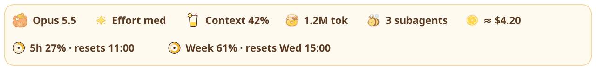
</picture>

Model, thinking effort, context used (a glass of lemonade, filled to the level), tokens this session, subagent runs, the equivalent cost at API prices (an estimate, not a bill), and the 5-hour and weekly limits with their reset times. (The meadow lamb's glass holds milk.) `/skin usage` opens the full pane.

### Little things

| | |
|---|---|
| 🍋 **Margin stickers** | lemons, daisies and bees drift along the sidebar and the right edge, clear of the conversation |
| 👆 **Click the margins** | a sticker pops where you click |
| 💬 **Message stickers** | each message gets a small sticker, picked from what it says |
| 🌙 **Dark mode** | follows the system: the gingham dims, the stickers stay |

See it before installing: the [**try-on page**](https://simpleciki.github.io/lemon-themes/) rebuilds the app in the browser. Switch skins, click the mascot, click the margins, switch to nap or dark.

## meadow-sheep

Soft felt-ball stickers: faint crayon-hatched paper, a little grassy hill on each side where trees and dandelions lean in the breeze, butterflies flapping past. The lamb in the corner blinks, lowers its head to graze, and curls up to sleep after ten quiet minutes.

<table>
<tr>
<td align="center" width="33%">
<br><b>Grazing</b><br><sub>Blinks, nibbles, looks up</sub>
</td>
<td align="center" width="33%">
<br><b>Napping</b><br><sub>Curls up, zzz; click the margins to wake it</sub>
</td>
<td align="center" width="33%">
<br><b>The backdrop</b><br><sub>Click the lamb for hearts; praise it for confetti</sub>
</td>
</tr>
</table>

## pond-duck

Oil-pastel crayon: a little pond on each side with reeds and lily pads. The duckling follows the clock: pecking by the pond by day, a nightcap and fireflies after 6 pm, and now and then a rainy day with a rain hat and puddles. `/skin` can pin one of the three.

<table>
<tr>
<td align="center" width="33%">
<br><b>Day</b><br><sub>Pecks and blinks; lotus and dragonflies</sub>
</td>
<td align="center" width="33%">
<br><b>Dusk</b><br><sub>A nightcap after 6 pm; moon and fireflies</sub>
</td>
<td align="center" width="33%">
<br><b>Rain</b><br><sub>A rain hat; rainbow, mushrooms, puddles</sub>
</td>
</tr>
</table>

## Switch skins, switch things off: `/skin`

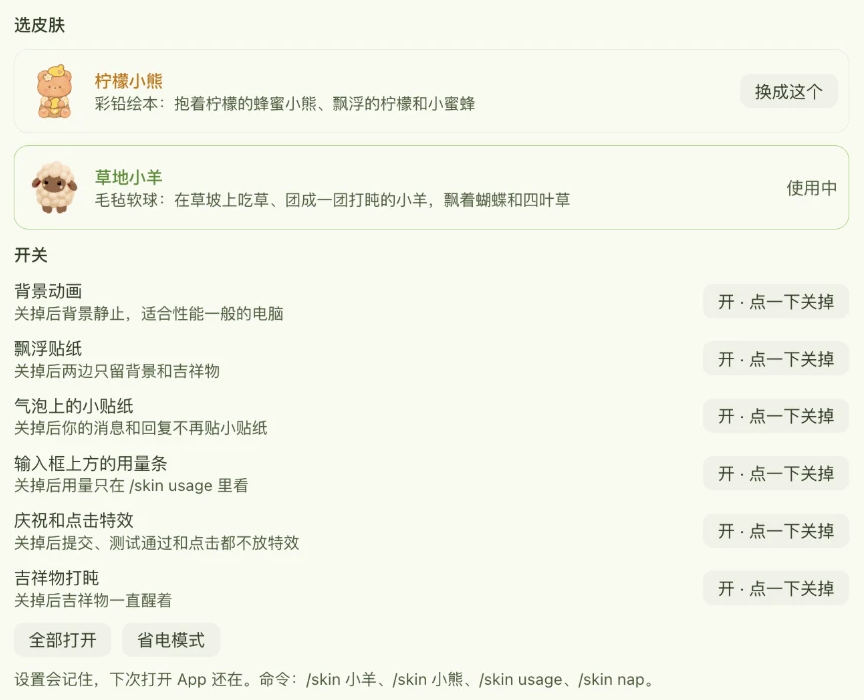

Type `/skin` (or press 皮肤 on the usage band) to open the pane:
- **Pick a skin**: it changes on the spot.
- **Nine switches**: backdrop motion, floating stickers, stickers on messages, the usage band, celebrations and click effects, the companion garden, the mascot's status bubble, the mascot talking, the mascot's nap. On a slow computer, 省电模式 turns motion, floating stickers and effects off at once.
- **Companion garden**: every successful `git commit` plants a flower on the left bank, and an all-green test run opens a little patch; every 10 flowers grow into a bush, every 100 the meadow levels up. The pane shows a line of totals. The record stays on your own computer, one line per day; if it cannot be read, the garden says "Can't read your garden records" rather than pretending the meadow is empty.

- **The mascot talks**: it says hello when you open the app, remembers how many days in a row you have met or how long you were away, and speaks up at the first flower, every 10th and 100th, late at night, and after three failures in a row ("No rush"). At most one ordinary line every 10 minutes.
- **Today's card**: `/skin share` opens a card of today: flowers planted, green runs, days in a row, the garden's total, with the mascot. Take a screenshot to post it; Copy text copies a caption. The card holds counts only, none of your code or file names.
- **Status bubble**: "…" while Claude thinks or runs a tool, "👋 your turn" while it waits for your approval or your answer, "!" when a tool fails.
- **It remembers** your choices across sessions.
- Commands: `/skin 小羊` or `/skin meadow-sheep`, `/skin 小熊` or `/skin lemon-bear`, `/skin duck` or `/skin pond-duck` (then `/skin dusk`, `/skin rain`, `/skin auto` for its look), `/skin usage` for the usage pane, `/skin nap` to put the mascot to sleep.

## Install

Needs Claude Code 2.1.330 or later (the backdrop click event, `ui.pointer`, arrived there).

At the prompt of a Claude Code terminal session:

```
/plugin install lemon-themes --marketplace simpleciki/lemon-themes
```

Answer `y` to "Add marketplace?" and pick the user scope. Or from a shell:

```bash
claude plugin install lemon-themes --marketplace simpleciki/lemon-themes
```

In the desktop app, where `/plugin` does not run: click + next to the prompt box, then Plugins, Add marketplace with `simpleciki/lemon-themes`, then Add plugin.

New sessions then wear the lemon bear; type `/skin` to switch to the meadow lamb or the pond duckling. The backdrop shows in the desktop and mobile apps; the terminal shows the band only.

Already have the old `lemon-bear` plugin? Disable it first (`claude plugin disable lemon-bear@lemon-themes`), then install `lemon-themes`, or the two will fight over the backdrop.

## Make a theme

See [skills/make-theme/SKILL.md](skills/make-theme/SKILL.md), after [docs/LESSONS.md](docs/LESSONS.md):
what the app will and will not play.

| Path | What |
|---|---|
| `plugins/lemon-themes/` | the plugin; each skin in `hooks/skins/<skin>/` |
| `plugins/lemon-bear/` | the old single-skin plugin, kept for people who installed it |
| `art-src/<theme>/` | source drawings, the prompt behind each, and `theme-build.json` |
| `tools/build_theme.py` | cuts the drawings apart and traces them into the plugin's vector data |
| `tools/build_site.mts` | builds the animated pictures on this page and the try-on page `docs/index.html` (`npx tsx tools/build_site.mts`) |
| `docs/LESSONS.md` | what we learned the hard way |

## License

MIT, see [LICENSE](LICENSE). `make-colors.js` comes from Claude Code's plugin-authoring kit and is not covered by it; see [NOTICE](NOTICE).
