<div align="center">

<a href="https://simpleciki.github.io/lemon-themes/">
<picture>
  <source media="(prefers-color-scheme: dark)" srcset="assets/lemon-bear/hero-dark.svg">
  
</picture>
</a>

**给 Claude 桌面 App 换上会动的手绘皮肤**

[**🍋 在线试穿**](https://simpleciki.github.io/lemon-themes/) · [English](README.en.md) · [做一套新主题](skills/make-theme/SKILL.md) · MIT

</div>

<br>

## 柠檬小熊 lemon-bear

绘本彩铅贴纸风：奶油格纹、柠檬、雏菊、蜜蜂，和一只戴黄贝雷帽的蜂蜜色小熊。下面的图都在动，跟 App 里一样。

<table>
<tr>
<td align="center" width="25%">
<picture><source media="(prefers-color-scheme: dark)" srcset="assets/lemon-bear/state-sit-dark.svg"></picture>
<br><b>坐着</b><br><sub>眨眼，轻轻摇头</sub>
</td>
<td align="center" width="25%">
<picture><source media="(prefers-color-scheme: dark)" srcset="assets/lemon-bear/state-sleep-dark.svg"></picture>
<br><b>打盹</b><br><sub>10 分钟没动静就睡，冒 zzz</sub>
</td>
<td align="center" width="25%">
<picture><source media="(prefers-color-scheme: dark)" srcset="assets/lemon-bear/state-hearts-dark.svg"></picture>
<br><b>点它</b><br><sub>跳一下，冒爱心</sub>
</td>
<td align="center" width="25%">
<picture><source media="(prefers-color-scheme: dark)" srcset="assets/lemon-bear/state-party-dark.svg"></picture>
<br><b>撒花</b><br><sub>夸它、提交成功、测试通过</sub>
</td>
</tr>
</table>

### 输入框上方的用量条

<picture>
  <source media="(prefers-color-scheme: dark)" srcset="assets/lemon-bear/band-dark.svg">
  
</picture>

模型、思考强度、上下文（一杯柠檬水，水位就是用量）、本次 Token、子 agent 次数、按 API 价折算的等价金额（估算，不是账单），以及 5 小时和每周额度与重置时间。`/lemon` 打开详细面板。

### 小细节

| | |
|---|---|
| 🍋 **两侧贴纸** | 柠檬、雏菊、小蜜蜂贴着侧边栏和右边缘慢慢漂，不挡对话 |
| 👆 **点空白处** | 两侧空白处一点就弹出一颗小贴纸 |
| 💬 **对话气泡** | 每条消息角上贴一张小贴纸，按内容挑 |
| 🌙 **深色模式** | 跟着系统切换，格纹压暗，贴纸不变 |

不装也能先看：[**在线试穿**](https://simpleciki.github.io/lemon-themes/) 在浏览器里还原了 App 的样子，可以点小熊、点空白处、切换睡觉和深色。

## 安装

需要 Claude Code 2.1.330 或更新的版本（背景点击事件 `ui.pointer` 从这一版才有）。

在终端里的 Claude Code 对话框输入：

```
/plugin install lemon-bear --marketplace simpleciki/lemon-themes
```

问「Add marketplace?」时回 `y`，范围选 user。也可以在命令行里装：

```bash
claude plugin install lemon-bear --marketplace simpleciki/lemon-themes
```

桌面 App 里 `/plugin` 不能用：点输入框旁边的 +，选 Plugins，Add marketplace 填 `simpleciki/lemon-themes`，再 Add plugin。

装好后新开的会话就是柠檬小熊。背景只在桌面 App 和手机 App 上显示；终端里只有用量条。

## 做一套新主题

见 [skills/make-theme/SKILL.md](skills/make-theme/SKILL.md)。先读 [docs/LESSONS.md](docs/LESSONS.md)：里面是 App 实际能播什么、不能播什么。

| 路径 | 内容 |
|---|---|
| `plugins/<主题>/` | 插件本体 |
| `art-src/<主题>/` | 原画和每张图的提示词记录，以及 `theme-build.json` |
| `tools/build_theme.py` | 把原画切开、描成矢量，生成插件要的数据 |
| `tools/build_site.mts` | 生成本页的动图和在线试穿页 `docs/index.html` |
| `docs/LESSONS.md` | 踩坑记录 |

## 许可证

MIT，见 [LICENSE](LICENSE)。`make-colors.js` 来自 Claude Code 的插件编写工具包，不在 MIT 范围内，见 [NOTICE](NOTICE)。
