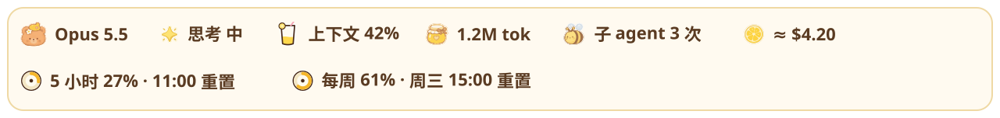

<div align="center">

<a href="https://simpleciki.github.io/lemon-themes/">
<picture>
  <source media="(prefers-color-scheme: dark)" srcset="assets/lemon-bear/hero-dark.svg">
  
</picture>
</a>

**给 Claude 桌面 App 换上会动的手绘皮肤**

[**🍋 在线试穿**](https://simpleciki.github.io/lemon-themes/) · [English](README.en.md) · [做一套新主题](skills/make-theme/SKILL.md) · MIT

</div>

<br>

## 柠檬小熊 lemon-bear

绘本彩铅贴纸风：奶油格纹、柠檬、雏菊、蜜蜂，和一只戴黄贝雷帽的蜂蜜色小熊。下面的图都在动，跟 App 里一样。

<table>
<tr>
<td align="center" width="25%">
<picture><source media="(prefers-color-scheme: dark)" srcset="assets/lemon-bear/state-sit-dark.svg"></picture>
<br><b>坐着</b><br><sub>眨眼，轻轻摇头</sub>
</td>
<td align="center" width="25%">
<picture><source media="(prefers-color-scheme: dark)" srcset="assets/lemon-bear/state-sleep-dark.svg"></picture>
<br><b>打盹</b><br><sub>10 分钟没动静就睡，冒 zzz；点空白处叫醒</sub>
</td>
<td align="center" width="25%">
<picture><source media="(prefers-color-scheme: dark)" srcset="assets/lemon-bear/state-hearts-dark.svg"></picture>
<br><b>点它</b><br><sub>跳一下，冒爱心</sub>
</td>
<td align="center" width="25%">
<picture><source media="(prefers-color-scheme: dark)" srcset="assets/lemon-bear/state-party-dark.svg"></picture>
<br><b>撒花</b><br><sub>夸它、提交成功、测试通过</sub>
</td>
</tr>
</table>

### 输入框上方的用量条

<picture>
  <source media="(prefers-color-scheme: dark)" srcset="assets/lemon-bear/band-dark.svg">
  
</picture>

模型、思考强度、上下文（一杯柠檬水，水位就是用量；草地小羊是一杯牛奶）、本次 Token、子 agent 次数、按 API 价折算的等价金额（估算，不是账单），以及 5 小时和每周额度与重置时间。`/skin usage` 打开详细面板。

### 小细节

| | |
|---|---|
| 🍋 **两侧贴纸** | 柠檬、雏菊、小蜜蜂贴着侧边栏和右边缘慢慢漂，不挡对话 |
| 👆 **点空白处** | 两侧空白处一点就弹出一颗小贴纸 |
| 💬 **对话气泡** | 每条消息角上贴一张小贴纸，按内容挑 |
| 🌙 **深色模式** | 跟着系统切换，格纹压暗，贴纸不变 |

不装也能先看：[**在线试穿**](https://simpleciki.github.io/lemon-themes/) 在浏览器里还原了 App 的样子，可以换皮肤、点吉祥物、点空白处、切换睡觉和深色。

## 草地小羊 meadow-sheep

毛毡软球风：淡淡的蜡笔草纹纸面、两边的小草坡、树和蒲公英在风里轻轻晃，蝴蝶扇着翅膀飘。右下角的小羊会眨眼、低头吃草，十分钟没动静就团成一团睡觉。

<table>
<tr>
<td align="center" width="33%">

<br><b>吃草</b><br><sub>眨眼，低头吃一口再抬头</sub>
</td>
<td align="center" width="33%">

<br><b>打盹</b><br><sub>团成一团，冒 zzz；点空白处叫醒</sub>
</td>
<td align="center" width="33%">

<br><b>整个背景</b><br><sub>点小羊冒爱心，夸它会撒花</sub>
</td>
</tr>
</table>

## 换皮肤和开关：`/skin`


输入 `/skin`（或点用量条上的「皮肤」）打开面板：
- **选皮肤**：点「换成这个」当场换。
- **8 个开关**：背景动画、飘浮贴纸、气泡上的小贴纸、用量条、庆祝和点击特效、陪伴花园、吉祥物报状态、吉祥物打盹。电脑比较慢就点「省电模式」，一次关掉动画、飘浮贴纸和特效。
- **陪伴花园**：每次成功的 `git commit` 在左边草坡种一朵花，测试全绿开一小片；每 10 朵长成花丛，每 100 朵草地升一级。面板里有一行统计。记录只存在你自己的电脑上，每天一行小结；读不到记录时会直接写「读不到花园记录」，不会假装是空草地。
- **吉祥物报状态**：Claude 在想或在跑工具时冒「…」小气泡，等你批准或回答问题时冒「👋 等你」，工具出错时冒「!」担心一下。
- **设置会记住**，下次打开 App 还在。
- 命令：`/skin 小羊`、`/skin 小熊` 直接换，`/skin usage` 看用量面板，`/skin nap` 让吉祥物马上睡。

## 安装

需要 Claude Code 2.1.330 或更新的版本（背景点击事件 `ui.pointer` 从这一版才有）。

在终端里的 Claude Code 对话框输入：

```
/plugin install lemon-themes --marketplace simpleciki/lemon-themes
```

问「Add marketplace?」时回 `y`，范围选 user。也可以在命令行里装：

```bash
claude plugin install lemon-themes --marketplace simpleciki/lemon-themes
```

桌面 App 里 `/plugin` 不能用：点输入框旁边的 +，选 Plugins，Add marketplace 填 `simpleciki/lemon-themes`，再 Add plugin。

装好后新开的会话就是柠檬小熊，输入 `/skin` 换成草地小羊。背景只在桌面 App 和手机 App 上显示；终端里只有用量条。

已经装了旧的 `lemon-bear` 插件？先停用它（`claude plugin disable lemon-bear@lemon-themes`）再装 `lemon-themes`，不然两个插件会抢背景。

## 做一套新主题

见 [skills/make-theme/SKILL.md](skills/make-theme/SKILL.md)。先读 [docs/LESSONS.md](docs/LESSONS.md)：里面是 App 实际能播什么、不能播什么。

| 路径 | 内容 |
|---|---|
| `plugins/lemon-themes/` | 插件本体；每套皮肤在 `hooks/skins/<皮肤>/` |
| `plugins/lemon-bear/` | 旧的单皮肤插件，留给已经装了的人 |
| `art-src/<主题>/` | 原画和每张图的提示词记录，以及 `theme-build.json` |
| `tools/build_theme.py` | 把原画切开、描成矢量，生成插件要的数据 |
| `tools/build_site.mts` | 生成本页的动图和在线试穿页 `docs/index.html`（`npx tsx tools/build_site.mts`） |
| `docs/LESSONS.md` | 踩坑记录 |

## 许可证

MIT，见 [LICENSE](LICENSE)。`make-colors.js` 来自 Claude Code 的插件编写工具包，不在 MIT 范围内，见 [NOTICE](NOTICE)。
